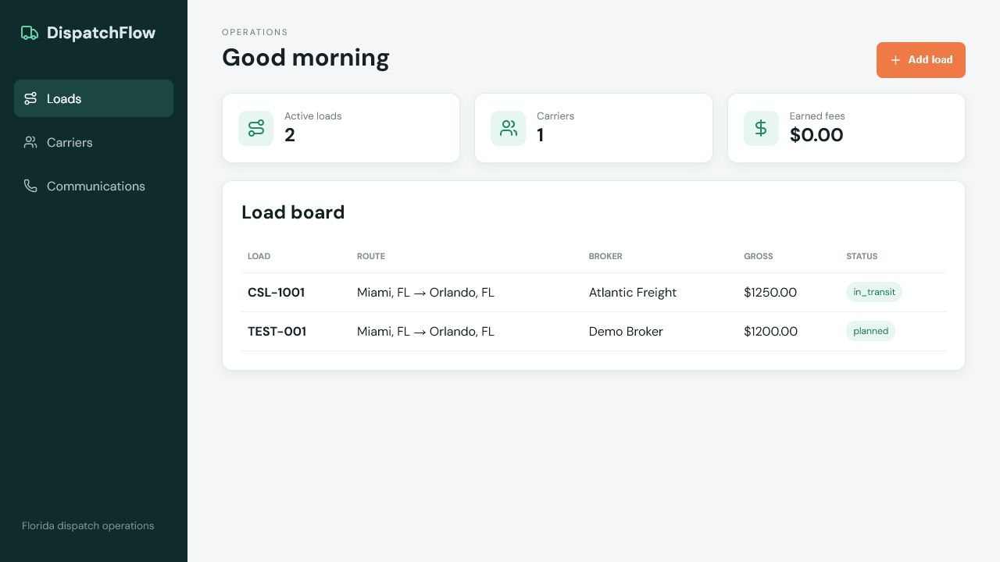

# DispatchFlow MVP

Lean dispatch-company operations platform: carriers, loads, dispatch-fee tracking, document extraction, SMS, realtime voice-session provisioning, PostgreSQL and n8n.

Planned public domain: `cslmllc.com`. The current application is a separate React/Node service and should be deployed behind a subdomain or integrated with WordPress through a small plugin/API layer rather than copied directly into a WordPress theme.

Business configuration: CSLM LLC, Winter Garden, Florida. Contact email: `cslmllc.support@gmail.com`. Introductory pricing is one free completed load, then a temporary 0.1% dispatch fee; the standard fee is 5%.

The operations foundation now also includes driver/equipment records, availability, expanded carrier onboarding fields, and draft invoice storage. UI workflows for these modules are the next incremental delivery.

## Cheapest Hostinger deployment

The installable WordPress/PHP/MySQL edition is in `wordpress-plugin/cslm-dispatch`. It runs on the existing managed WordPress hosting plan without Node.js, PostgreSQL, Docker, or n8n. The administrator dashboard is protected by the normal WordPress login and `manage_options` capability.

Install package: `C:\Users\vpulatov_sticky\projects\cslm-dispatch.zip`

This first WordPress release includes carriers, drivers/equipment, loads, invoices, the free-first-load offer, promotional 0.1% fee, standard 5% fee, and CSLM company contact details. Live WordPress activation must be verified after upload before the release is treated as deployed.

Version 0.2.0 adds a public one-page dispatch-services site, click-to-reveal email, driver/carrier application intake, service-agreement previews, an administrator Applications queue, and a dedicated full-width WordPress page template. The public page intentionally does not display the business phone number.

Build the package with `powershell -File wordpress-plugin/package.ps1`. The ZIP name intentionally matches the top-level plugin folder so WordPress installs the correct plugin path.

## Current dashboard



## Start without external services

```powershell
npm install
npm run install:all
npm run dev
```

Open `http://localhost:5173`. Without `DATABASE_URL`, the API intentionally uses temporary in-memory demo data.

## Start PostgreSQL and n8n

```powershell
Copy-Item .env.example .env
docker compose up -d
npm run dev
```

Dashboard: `http://localhost:5173` · API: `http://localhost:4000/api/health` · n8n: `http://localhost:5678`

## Integrations

Add keys to `.env`; never commit it. Twilio sends SMS through `POST /api/notifications/sms`. OpenAI extracts rate-confirmation fields through `POST /api/documents/extract` and provisions short-lived Realtime client secrets through `POST /api/realtime/session`. Human approval is required before booking or committing to a load.

## Production gaps

Before real customer data: authentication/roles, encryption and backups, audit trail, carrier-document access controls, webhook validation, rate limiting, tests for integration failures, privacy/terms, and a legal review of dispatch workflows.
